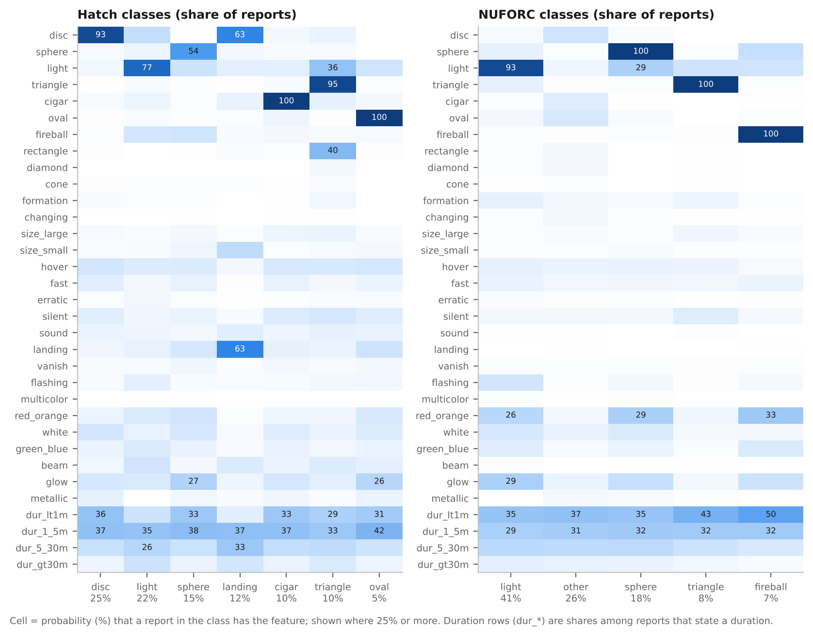
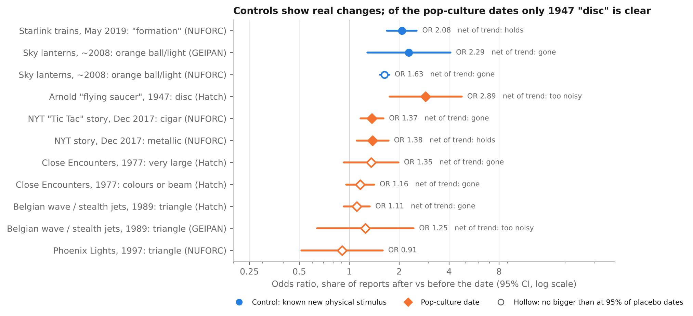
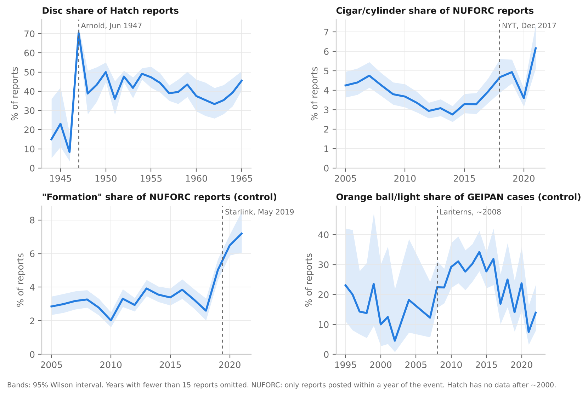
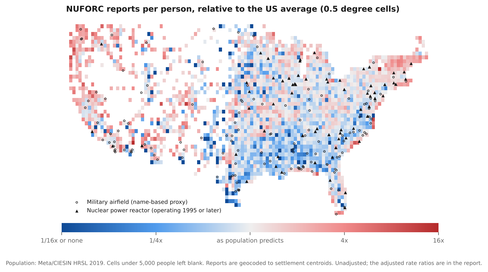

# UAP craft taxonomy: stable types, cultural drift, and where they fall

*2026-11-26. UFOAI branch `claude/project-thread-loq0td`. Code: `omega/taxonomy/` (run order in its
README). Every number below is printed in [`craft_taxonomy_tables.md`](craft_taxonomy_tables.md), which
`omega/taxonomy/report.py` generates from the result files. Parts that rest on a judgement call or an
inferred layer are marked **(inferred)**.*

---

## Bottom line

1. **Reports do fall into a few stable description types.** Larry Hatch's worldwide catalogue (18,116
   cases) splits into 7 classes. 6 of the 7 re-appear in at least 10 of 12 independent region and
   decade subsets, above a shuffled-data floor. NUFORC (133,251 reports) supports 5 classes, and all 5
   re-appear in at least 10 of 13 subsets. Point of light, sphere and triangle are the same class in
   every catalogue that has them. GEIPAN (3,404 cases) supports only 2.
2. **Stable types are not craft types.** GEIPAN explained between 48% and 79% of every shape it received
   (lanterns, aircraft, stars and planets, balloons, re-entries), and no shape is mostly unexplained.
   When the stimulus mix changes, the classes change with it: GEIPAN cases from 2010 on grow a
   "silent orange sphere, 1–5 minutes" class, and GEIPAN explained 201 of those cases as sky lanterns
   and left 1 unexplained. A class is like a book genre. "Thriller" is perfectly stable across
   countries and decades, and it still tells you nothing about who wrote the book.
3. **Culture moves the words, clearly once.** The share of discs in Hatch jumps at 1947, the year
   "flying saucer" was coined: odds ratio (OR) 2.89 (1.75–4.76) after removing the 1946 ghost-rocket
   cigars, bigger than the change at any of 45 other years. After the December 2017 *New York Times*
   story, "metallic" steps up and survives a trend adjustment, but one such hit in 15 cultural
   comparisons is about what chance gives. *Close Encounters*, the Belgian wave and stealth reveal,
   and the Phoenix Lights show nothing. The same tests do pick up real new stimuli: Starlink trains and
   sky lanterns both show.
4. **No excess near bases or reactors once you count people, with one lead to watch.** Per person, US
   reports are 22–26% *lower* within 25 km of a military airfield and no higher near nuclear plants, for
   every class. Hatch's triangles do sit nearer operating reactors than other Hatch reports (OR 1.48,
   1.25–1.74, era-adjusted), but most of that is two waves: Hudson Valley 1982–87 and Belgium 1989–91.
   Without them it is 1.18 (0.98–1.41), and NUFORC's modern US triangles show nothing (0.94). Discs are
   slightly over-represented near military airfields in both Hatch (1.16) and NUFORC (1.09).
5. **Altitude and emptiness predict reports, not sites.** Per person, reporting is 2.2–2.7 times higher
   above 2,000 m. That fits dark skies and people outdoors at night, whom a count of residents misses.
6. **GEIPAN's unexplained cases do read differently.** They mention triangles, cigars, hovering,
   silence and orange more often, beyond what their longer write-ups explain (cross-validated AUC 0.737
   against 0.707 for text length alone; p = 0.005). GEIPAN decides "unexplained" partly from those
   same words, so this is a lead, not a finding.

---

## What was used

| source | reports | years | what was coded | location |
|---|---|---|---|---|
| NUFORC (`evidence_vault/06_NUFORC_MODERN_ARM`) | 133,251 (134,906 less 1,655 automated MADAR sensor posts) | 1928–2025, 85% from 2000 on | reporter's shape field, one-line summary, duration | town centroid (Wikidata / Nominatim), 92% placed |
| Hatch *U* database (`ufo_data/bin/hatch_udb.json`) | 18,116 | mostly 1945–2003 | Hatch's own codes, terse description, duration in minutes | Hatch's coordinates |
| GEIPAN (`data/raw/geipan/geipan_cases.json`) | 3,404 | 1937–2026 | witness-side French text only; GEIPAN's A/B/C/D class and explanation kept apart | commune |

Hatch's catalogue is used non-commercially; the `ufo_data` README records that his family gave verbal
permission for its use. **Not used:** MUFON's case database is not public, so it is missing. That is a
gap, not a choice. The other `ufo_data` chronologies (Eberhart, Magonia, NICAP, Dolan and others) are
narrative timelines that re-list the same famous cases with no shape field, so they would double-count.
`ufo_data_search` is the search front end for that same corpus and holds no extra cases.

---

## How it was done

**Coding.** 33 yes/no features from a keyword lexicon in English and French, auditable line by line in
`features.py`: 12 shapes, 2 sizes, 7 motion and sound features, 8 light and surface features, plus
duration in 4 bands. Negations are handled ("sans bruit" is silence, not sound). For GEIPAN, only the
witness part of the case text is coded, because the rest contains the investigators' explanation.
NUFORC summaries are one line, so they code about 2.3 features per report, against 3.4 for GEIPAN. That
is why classes are fitted **within** each source and only compared across sources.

**Classes.** Latent class analysis, a mixture model that asks which features travel together. Duration
enters as one categorical item: as four yes/no items it took over the model. The number of classes K
is the largest for which every class re-appears in each of three random half-splits (profile
correlation r ≥ 0.7, mean ≥ 0.8), with 12 random restarts per fit. With fewer restarts, local optima
looked like failures to replicate.

**Stability.** For each region or decade, fit the model on that subset and, separately, on everything
else, then match classes by their profiles. Two references go with each score. The **ceiling** is a
random same-size draw from the other records, so pure sampling noise. The **floor** is the subset with
each feature shuffled on its own, so frequencies are kept and co-occurrence is destroyed. A class counts
as replicated only if r ≥ 0.7 **and** r beats its own floor. The floor matters: a class that is just one
feature ("cigar 100%") is re-created from shuffled data.

**Drift.** For each dated event, the share of a feature in equal windows before and after (OR with 95%
CI); the same OR at every other possible date (placebo dates); and an interrupted time series that
nets out the pre-existing trend, with its own placebo. Two controls with a known physical cause test
whether the method can see anything at all: Starlink trains (first launch May 2019) and sky lanterns
(a fad in France and the US from about 2008). NUFORC drift tests use only reports posted within a year
of the event, so late recollections can't pick up later vocabulary.

**Geography.** The null is people, not area: Meta/CIESIN High Resolution Settlement Layer 2019 for the
US (318 million people in the contiguous states), summed to 0.05° cells (about 5 km). Reports per person
are modelled as quasi-Poisson with population-density decile and four longitude regions as covariates,
in distance bands from each site type, with ≥ 100 km as the reference. Each class is also tested against
the other reports in the same cells, which takes population out of the question. Everything is run
again on 0.25° cells (about 25 km), because a town's reports all land on its centroid. Outside the US
there was no population layer, so Hatch and GEIPAN are tested class against class, adjusted for region
and period. Sites: OurAirports civil airports; military airfields picked out of OurAirports by name
(AFB, NAS, Army Airfield...) **(inferred layer)**; GeoNuclearData power reactors, counted only in years
they operated; Natural Earth coastline; Copernicus GLO-90 elevation and relief.

---

## 1. The classes

Each class is a set of features that travel together. The share is of all reports in that source; the
percentages say how often the class's reports carry each feature.

**Hatch, worldwide, 7 classes**

| class | share | defined by | what stands out in Hatch's own flags |
|---|---|---|---|
| disc | 25.2% | disc 93% | fewest "likely misidentification" flags (2%) |
| point of light | 21.9% | light 77% | most radar (6%) and military observers (25%) |
| glowing sphere | 15.1% | sphere 54%, glow 27% | |
| landing / close encounter | 12.4% | landing 63%, disc 63%, small 23%, 5–30 minutes 33% | landing 80%, small humanoid 28%, traces 24%, EM effects 14%; strangeness 8.1 against 6.1–6.6 |
| cigar | 10.3% | cigar 100% | |
| triangle / box | 10.2% | triangle 95%, rectangle 40% | |
| oval | 5.0% | oval 100%, glow 26% | |

**NUFORC, mostly US, 5 classes**

| class | share | defined by |
|---|---|---|
| point of light | 41.3% | light 93%, glow 29% |
| other shapes | 25.7% | no dominant feature; disc 19% and oval 16%, against 7% each overall |
| sphere | 17.9% | sphere 100%, red or orange 29% |
| triangle | 7.7% | triangle 100% |
| fireball | 7.4% | fireball 100%, red or orange 33%, under a minute 50% |

**GEIPAN, France, 2 classes:** point of light (36.8%; light 100%, white 33%) and everything else (63.2%,
no dominant feature).

Three things to notice:
- **Shape runs every model.** Colour, motion, sound and duration modify classes but never define one on
  their own. The one class built on more than shape is Hatch's landing class.
- **NUFORC's classes mirror its own menu.** Light, sphere, triangle and fireball are choices on NUFORC's
  shape drop-down, so part of this taxonomy is the form witnesses fill in.
- **The number of classes follows coding depth, not sample size.** NUFORC is seven times Hatch's size,
  but its one-line summaries code fewer features, so it supports fewer classes. (Hatch's selection
  passed K = 6 and 7 after failing K = 5; tables §1.)

---

## 2. Are they stable across countries and decades?

A class counts in a subset if it re-appears there with r ≥ 0.7 and beats its shuffled floor.

| Hatch class | re-appears in (of 12) | NUFORC class | re-appears in (of 13) |
|---|---|---|---|
| disc | 12 | sphere | 13 |
| triangle / box | 12 | point of light | 12 |
| point of light | 11 | other shapes | 12 |
| landing | 11 | triangle | 10 |
| glowing sphere | 10 | fireball | 10 |
| cigar | 10 | | |
| oval | 6 | | |

Hatch's subsets are 7 world regions and 5 eras. NUFORC's are 8 regions (4 US longitude bands, Canada,
UK, Australia and New Zealand, rest of the world) and 5 eras.

**Across countries the classes hold.** Hatch's classes re-appear in France, the rest of Europe, Latin
America, the UK, the US, and Canada with Australia and New Zealand. The misses are small classes in small
subsets: oval fails in 4 of 7 regions, cigar in the UK (r = 0.26) and in Asia/Africa, sphere in
Asia/Africa. NUFORC's classes hold in every US region and abroad, with two exceptions. Fireballs miss
in Australia and New Zealand (684 reports). Triangles miss in the US East, because the model there
spends its fifth class on ovals and folds triangles into "other shapes" (diagnostic in tables §3). That
is a contest for the last slot the data can support, not a lack of triangles in the East.

**Across decades they mostly hold, and the misses are informative.**
- *Hatch before 1950* (1,079 cases): only disc, cigar and triangle re-appear.
- *NUFORC* holds from the 1990s through the 2010s and fails at both ends. Every one of its 8,282
  reports of pre-1990 events was posted in 1995 or later, and in that set the triangle, fireball and
  "other shapes" classes don't re-appear. In the 2020s (8,298 reports) the fireball class disappears
  (r = 0.16) and the point-of-light class fails against a high floor. That is the Starlink and drone
  era. **(inferred)**
- *GEIPAN's* two classes re-appear before 1980, partly in 2000–09, and fail in 1980–99 and from 2010.
  Fitting the 2010+ cases on their own shows why. Their second class is "silent red-orange sphere,
  1–5 minutes" (16.5%). GEIPAN explained 201 of those cases as sky lanterns, 10 as aircraft and 10 as
  meteors, and left 1 unexplained. Before 2010 the second class was "flashing white light, 5–30
  minutes". The classes moved because what was in the sky moved.

The shape vocabulary is stable across countries. The mix shifts over time as new things appear in the
sky.

---

## 3. Are they the same classes in different catalogues?

Classes are matched across catalogues on their shared features, each centred on its own averages. This
is the weakest test, because the three sources code at different depths.

| class | Hatch ↔ NUFORC | Hatch ↔ GEIPAN | GEIPAN ↔ NUFORC |
|---|---|---|---|
| point of light | 0.84 | 0.84 | 0.97 |
| triangle | 0.82 | (no GEIPAN class) | (no GEIPAN class) |
| sphere | 0.74 | (no GEIPAN class) | (no GEIPAN class) |
| Hatch disc ↔ NUFORC "other shapes" | 0.49 | | |
| GEIPAN "everything else" ↔ NUFORC "other shapes" | | | 0.69 |

Point of light, sphere and triangle are the same class in every catalogue that has them. Discs are a
class of their own in Hatch but fold into "other shapes" in NUFORC. Fireballs are a class only in
NUFORC; cigars and landings only in Hatch. The matching forces Hatch's cigar onto NUFORC's fireball at
r = 0.02, which is no match.

---

## 4. What is inside the classes

This is the test that decides whether a stable class is a craft type. GEIPAN investigated every case and
recorded what most of them turned out to be. If "triangle" were a kind of craft, explained triangles
should be rare.

| shape in the witness text | cases | explained (A+B) | unexplained (D) | most common explanations |
|---|---|---|---|---|
| fireball | 174 | 79% | 2.3% | meteors and re-entries, lanterns, aircraft |
| formation | 130 | 75% | 1.5% | lanterns, balloons, aircraft, satellites |
| sphere | 753 | 68% | 2.8% | lanterns, astronomical, re-entries, balloons |
| light | 1,489 | 66% | 3.5% | lanterns, aircraft and drones, astronomical, satellites |
| oval | 136 | 62% | 3.7% | ground lights and lasers, aircraft, balloons |
| rectangle | 77 | 56% | 7.8% | aircraft, astronomical, lanterns |
| cigar | 110 | 54% | 10.0% | aircraft and drones, balloons, satellites |
| disc | 100 | 51% | 4.0% | astronomical, lanterns, ground lights, balloons |
| triangle | 268 | 48% | 6.7% | aircraft and drones, lanterns, balloons |

The rest of each row is GEIPAN class C (not enough information to decide). "Identified, type not given"
is left out of the explanation list. Every shape is mostly explained, and the explanations for any one
shape span unrelated objects. Lanterns turn up as spheres, lights, discs, triangles and formations.
The class is what the thing looked like. It isn't what the thing was.

**The classes don't sort the unexplained either.** GEIPAN's two classes hold unexplained cases at the
same rate, 2.9% and 3.4% (Cramér's V = 0.018, p = 0.39). In Hatch, the landing class is the odd one: the
highest strangeness, the most traces and EM effects, and also the most suspected hoaxes (4% against 1%)
and the fewest high-quality observers (37% against 42–52%). Hatch's "likely misidentification" flag runs
2–8% in every class. In NUFORC, 9.4% (triangle) to 16.4% (point of light) of summaries name a
conventional object, as an explanation or as a comparison.

**Do GEIPAN's unexplained cases describe something different?** Yes, modestly. Against 2,278 explained
cases, the 106 D cases mention these more often, adjusted for text length (D write-ups are longer,
because GEIPAN reserves D for detailed, consistent testimony):

| feature | D | explained | OR adjusted for length (95% CI) | BH q |
|---|---|---|---|---|
| cigar | 10.4% | 2.6% | 3.71 (1.85–7.42) | 0.003 |
| triangle | 17.0% | 5.6% | 2.95 (1.70–5.09) | 0.003 |
| hover | 24.5% | 8.7% | 2.42 (1.49–3.92) | 0.004 |
| silent | 57.5% | 39.0% | 1.95 (1.31–2.91) | 0.008 |
| red or orange | 49.1% | 31.5% | 1.84 (1.23–2.73) | 0.015 |
| glow | 57.5% | 65.9% | 0.54 (0.36–0.81) | 0.015 |

The whole profile separates D from A/B with a cross-validated AUC of 0.737. Text length alone gives
0.707, and features shuffled within length deciles give 0.662 (95th percentile 0.695, p = 0.005). So the
words carry a little signal beyond length. The catch is circularity: an investigator who reads "silent
hovering triangle" is less likely to settle on a lantern, so D is partly *defined* by these words.
**(inferred)** The usable lead is narrower. A silent, hovering triangle or cigar is the description a
professional investigation most often leaves unexplained, and even so, 48% of triangles and 54% of
cigars were explained.

---

## 5. Do the classes drift with pop culture?

**First, can the method see a real change?** Yes.
- *Starlink, May 2019.* "Formation" in NUFORC went from 2.97% to 6.00% of reports (OR 2.08, 1.69–2.55),
  bigger than at any placebo date, and the change holds net of the trend. Without the word "Starlink"
  in the summary, lines of lights still double (OR 2.03, 1.30–3.17).
- *Sky lanterns, about 2008.* Orange balls and lights in GEIPAN went from 13.2% to 26.4% of cases (OR
  2.29, 1.29–4.08). GEIPAN explained 254 of the 511 such cases from 2008 on as lanterns, and none of
  the 261 before. The rise is gradual, so it does not survive the trend adjustment as a step. A slow
  fad is a trend, and that is what the adjustment should say.

**Then the culture tests** (15 comparisons around 6 dated events; full table in the tables file, §8):

| event | feature | before → after | OR (95% CI) | beats placebo dates | net of trend |
|---|---|---|---|---|---|
| Arnold "flying saucer", June 1947 | disc (Hatch, 1946 cigars removed) | 32.4% → 58.3% | 2.89 (1.75–4.76) | 100% | too noisy |
| *Close Encounters*, Nov 1977 | very large (Hatch) | 3.2% → 4.2% | 1.35 (0.93–1.98) | 65% | not separable |
| *Close Encounters*, Nov 1977 | colours or beam (Hatch) | 15.1% → 17.2% | 1.16 (0.96–1.41) | 25% | not separable |
| Belgian wave / stealth reveal, 1989–90 | triangle (Hatch) | 25.7% → 27.8% | 1.11 (0.93–1.33) | 12% | not separable |
| Phoenix Lights, March 1997 | triangle (NUFORC) | 13.1% → 12.3% | 0.91 (0.52–1.59) | 70% | window too short |
| *NYT* "Tic Tac" story, Dec 2017 | cigar or cylinder (NUFORC) | 3.6% → 4.9% | 1.37 (1.17–1.61) | 100% | not separable |
| *NYT* story, Dec 2017 | metallic (NUFORC) | 1.8% → 2.5% | 1.38 (1.11–1.72) | 97% | holds: 2.31 (1.24–4.29) |
| digital-camera "orbs", 2008 | the word "orb" (NUFORC) | 1.4% → 5.0% | 3.79 (3.33–4.30) | 100% | not separable |

How to read it:
- **1947 is real and large.** The disc share jumps more at 1947 than at any of 45 other years. That's
  the signature of a name reshaping descriptions. The trend adjustment can't confirm or deny it,
  because the six years before 1947 hold only 71 non-cigar reports.
- **2017 cigars were already rising.** The cigar step disappears once the rise that began around 2014
  is allowed for. "Metallic" survives, but with 15 comparisons, one result beating 97% of placebo dates
  is roughly what chance delivers (about a one-in-three chance of at least one). Treat it as unconfirmed.
- **The famous visual events left no mark on shape.** Spielberg's mothership, the Belgian triangles
  and the Phoenix V did not change what people reported in the following years.
- **"Orb" is a word that spread slowly.** It quadrupled, but smoothly, so no single event drove it.

---

## 6. Where do the classes fall?

**US, all reports, per person** (NUFORC, 107,976 reports placed in 255,077 populated 5 km cells; rate
ratios against ≥ 100 km, adjusted for density and region):

| within 25 km of | 5 km cells | 25 km cells | reading |
|---|---|---|---|
| military airfield **(inferred layer)** | 0.74 (0.70–0.78) | 0.78 (0.73–0.84) | fewer reports per person near bases, at both scales |
| nuclear power plant | 0.89 (0.81–0.96) | 1.04 (0.95–1.14) | no excess at either scale |
| civil airport | 0.37 (0.30–0.46) | 0.72 (0.56–0.93) | depends heavily on cell size; mostly a town-centroid effect **(inferred)** |

With all three site types in one model, the 25 km cells give military 0.86 (0.81–0.91) and nuclear 1.11
(1.02–1.22). The 5 km cells give nuclear 0.96 (0.89–1.05). An 11% excess that shows at one cell size
and not the other is not a finding.

**Terrain** is the strongest pattern in the data, at both scales:

| per person, against the reference band | 5 km cells | 25 km cells |
|---|---|---|
| elevation 1,000–2,000 m (vs < 300 m) | 1.83 (1.70–1.98) | 1.64 (1.51–1.79) |
| elevation > 2,000 m | 2.69 (2.25–3.23) | 2.23 (1.90–2.63) |
| more than 200 km from the coast (vs < 10 km) | 1.20 (1.13–1.26) | 1.12 (1.05–1.19) |

These are net of population density, which matters even more: the sparsest tenth of cells report 25
(5 km cells) to 33 (25 km cells) times as much per resident as the densest tenth. Part of that is
geocoding, since a rural sighting lands on the nearest town. The rest fits dark skies, a big open sky,
and visitors who don't live there: campers, hikers and drivers are under the sky but not in a census
of residents. **(inferred)**

**By class, US.** Against the other reports in the same cells, every NUFORC class sits within 6% of the
rest near military airfields and reactors, at both scales (tables §9). Point-of-light reports are a
little scarcer near airfields (0.95, 0.93–0.98, BH q = 0.007). The one shape that leans toward bases is
disc: 1.09 (1.01–1.17) on 5 km cells and 1.09 (1.00–1.18) on 25 km cells, BH q about 0.2. NUFORC's
triangles sit no nearer reactors than other reports: 0.94 (0.85–1.05) at both scales. No class has
terrain of its own either. Fireballs lean coastal (0.86, 0.81–0.92, more than 200 km inland), and
triangles are scarcer on the highest ground (0.73 above 2,000 m on 5 km cells, not significant on 25 km
cells). Fireballs are also scarcer near civil airports (0.78 and 0.70 at the two scales, BH q 0.1–0.3).

**Hatch, worldwide.** Each class is compared with the other Hatch reports, adjusted for region and
5-year period. The period matters. Reactors came on line through the 1970s and 1980s, the same years
triangles rose from 4% to 25% of Hatch's cases, so a region-only model reads that shared trend as
"triangles near reactors" (OR 2.63).

| Hatch class, within 50 km | OR adjusted (95% CI) | BH q | without the two waves | one report per place and year |
|---|---|---|---|---|
| triangle / box, operating reactor | 1.48 (1.25–1.74) | < 0.001 | 1.18 (0.98–1.41) | 1.29 (1.08–1.56) |
| oval, operating reactor | 1.30 (0.98–1.71) | 0.14 | 1.38 (1.04–1.81) | 1.37 (1.04–1.82) |
| disc, military airfield | 1.16 (1.07–1.25) | 0.003 | 1.16 (1.07–1.25) | 1.10 (1.01–1.20) |
| triangle / box, military airfield | 1.15 (1.03–1.29) | 0.06 | 1.13 (1.01–1.27) | 1.15 (1.02–1.30) |

The other 10 class-and-site pairs are at or below 1 (tables §10).

The triangle–reactor link is the strongest site signal in this study, and most of it is two episodes.
The Hudson Valley wave (a box from New York City up the Hudson to western Connecticut, 1982–87) has 57
Hatch records, 47 of them within 50 km of an operating reactor, mostly Indian Point. Plant guards
reported Indian Point overflown in July 1984 (the account in Hynek, Imbrogno and Pratt, *Night Siege*,
1987; not re-checked for this report). The Belgian wave (1989–91) has 52, of
which 31 are within 50 km. Belgium is small, and its Doel and Tihange plants are within 50 km of much of
it. A wave is one episode seen by many people, so these are 2 data points, not 78 **(inferred)**.
Without them the link falls to 1.18 (0.98–1.41), and NUFORC's 8,539 modern US triangles show none of it.
It's a lead about two famous waves, not a pattern.

Discs near military airfields are the only signal in both catalogues: Hatch 1.16, NUFORC 1.09. It is
small. Military witnesses, aircraft around bases, and the old reporting route through bases (Project
Blue Book took its reports from base intelligence officers) would each produce it. **(inferred)**

**France.** GEIPAN's 106 unexplained cases against its 2,278 explained ones, adjusted for era: reactors
within 30 km 0.80 (0.32–2.03), military airfields within 30 km 1.44 (0.90–2.32). Only 5 unexplained
cases fall within 30 km of a reactor, so this test can't see a small effect in either direction. It
agrees with the null an earlier thread found on the PRIS reactor layer (GEIPAN Phase 2).

---

## 7. Red team

Points against these results, strongest first.

1. **The words are not the object.** Everything here is coded from what witnesses wrote, through a
   keyword lexicon. A stable class means stable *descriptions*. Section 4 shows the descriptions are
   produced by many different stimuli.
2. **Hatch is one compiler.** Seven classes replicating across countries could be Hatch's own coding
   habits replicating. His DLT code covers "delta/vee/boomerang/rectangular", so the triangle class is
   partly his category.
3. **Researcher degrees of freedom.** Events, features, windows and the 1947 composition fix were
   chosen during the analysis, not pre-registered. Fifteen comparisons give about 1.5 false "holds" at the 90% placebo
   threshold. The 1947 jump is the only one large enough to survive that. The two diagnostics in §2
   (GEIPAN by era, NUFORC US East) were added after seeing the failures, and are labelled so.
4. **1947 is a vocabulary change and a source change at once.** Hatch's pre-1947 records are dominated
   by WWII foo fighters and the 1946 Scandinavian ghost rockets, from a few compilations. A disc jump is
   what a naming effect predicts, and it is also what a change of source mix produces.
5. **Outside the US there is no population null.** The Hatch and GEIPAN site tests compare classes
   with each other. They can say triangles sit nearer reactors than discs do. They can't say anyone
   reports more near reactors than the people living there would predict.
6. **The triangle–reactor verdict rests on treating a wave as one episode.** Count the 78 wave reports
   as independent and the link is real at 1.48. One episode is the better unit, but that is a
   judgement.
7. **Geocodes are town centroids.** Nothing under about 10 km is resolvable. The airport result in
   particular flips with cell size.
8. **The military layer misses most of the military.** It catches flying bases by name. It misses
   missile fields (the Malmstrom and Minot ICBM fields are the classic UAP claims), ranges, test sites,
   depots and labs. The null near airfields says nothing about those.
9. **Population is 2019.** It is applied to reports from 1990 to 2025, so fast-growing western metros
   make older reports per person look slightly higher there.
10. **Density stands in for dark sky.** No light-pollution layer was reachable from this environment.
    The altitude effect may be a dark-sky effect, a tourism effect, or both.
11. **GEIPAN's D label is partly decided from the words being tested.** Section 4 can't escape that.
12. **NUFORC summaries are edited by NUFORC staff,** and the shape field is a drop-down that shapes the
    answer.
13. **MUFON is missing.** The largest US investigated case set is not public.

---

## 8. What would change the verdict

- **A class that is mostly unexplained.** If some combination of features formed its own class and
  GEIPAN, or any investigating body, explained few of its cases, that class would be a candidate
  "type". Today none exists. Re-run when more D cases accumulate.
- **Triangles near reactors outside the two waves.** Test the link in catalogues with their own
  locations: the UK MoD files, Canada's UFO reports, MUFON if it ever opens. A link that holds with
  Hudson Valley and Belgium removed, in data Hatch never touched, would be a real result.
- **An excess near the sites that matter, against people.** The real military layer: DoD's MIRTA
  installations-and-ranges dataset plus the ICBM fields, at both cell sizes. A per-person excess that
  holds at 5 and 25 km would count. The airfield proxy shows a deficit.
- **Sensor-first data.** Radar or multi-instrument detections coded by what the instrument measured,
  not by what a witness wrote. Description classes can't be separated from descriptions.
- **A shape that rises without a stimulus and without a story.** If a description jumps in many
  countries at once with no launch, fad or media event behind it, culture can't explain it.

---

## 9. Reproduce

From the UFOAI root with the sibling `ufo_data` checkout, follow `omega/taxonomy/README.md` (ten steps,
about two hours on four cores, plus a 962 MB population download). Derived grids, model outputs and
the fetch manifest (URLs and SHA-1s of every downloaded file) are in `evidence_vault/12_CRAFT_TAXONOMY/`.

## Sources

- NUFORC database, via the project vault (`evidence_vault/06_NUFORC_MODERN_ARM/`).
- Larry Hatch, *U* UFO database (1994–2002), JSON conversion by Richard Geldreich Jr.,
  github.com/richgel999/ufo_data.
- GEIPAN case files, CNES (geipan.fr), via `data/raw/geipan/`.
- Meta and CIESIN, High Resolution Settlement Layer 2019 (CC BY 4.0), dataforgood-fb-data on AWS.
- Copernicus GLO-90 DEM, ESA and Airbus, copernicus-dem-90m on AWS.
- OurAirports (public domain); GeoNuclearData (cristianst85, ODbL, from WNA and IAEA PRIS); Natural Earth.
- J. Allen Hynek, Philip J. Imbrogno and Bob Pratt, *Night Siege: The Hudson Valley UFO Sightings*
  (Ballantine, 1987), for the July 1984 Indian Point account.
